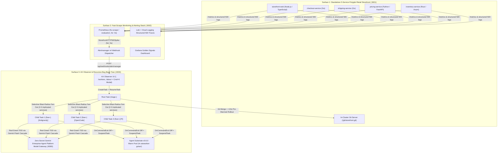

# The Self-Spawning Bug Bash Tree (`ax-bug-bash`)

**Recursive Sub-Task Fan-Out on `google/ax` and Agent Substrate `v0.6.0` on GKE**

> *"A single task may be the whole job, or it may be the root of a large tree of tasks spawned as the agent breaks the problem down."* (`google/ax`, `docs/concepts.md`)

`ax-bug-bash` demonstrates a self-spawning hierarchical agent system built on **`google/ax`** and **Agent Substrate `v0.6.0`** on Google Kubernetes Engine (GKE). When a production error occurs in a standalone **5-service polyglot Retail Storefront** (`Node.js/TypeScript`, `Go`, `Python/FastAPI`, `Rust/Axum`), an in-cluster **Prometheus + Alertmanager + Loki + Grafana** monitoring stack detects the HTTP 500 spike within 3 to 5 seconds and fires an Alertmanager webhook to the **AX Observer**.

The AX Observer dispatches a **Root Task** (`triage-<id>`) on `google/ax`. The Root Task analyzes the multi-service stack traces, identifies **only the 2 to 3 implicated microservices** (never blindly all 5), and calls `ax-server` gRPC (`ax.v1alpha1.AX/CreateTask` + `ResumeTask`) to dynamically fan out isolated **Child Tasks** (`fixer-<id>-<service>`) across warm `ateworker-gvisor` sandboxes. Each Child Task executes a strict **Red-Green TDD cycle**: authoring a new failing **Regression Test** first (Red), patching the service code until all tests pass (Green), capturing its unified Git diff via the **Custom Runner** (`runner.Run` `OnCommandExit`), and calling `SuspendTask` so Agent Substrate `v0.6.0` immediately reclaims worker CPU and memory slots. The Root Task merges the verified patches and triggers a `< 10s` pre-warmed incremental rollout that heals the live Retail Storefront.

---

## Architecture Overview



---

## Three Decoupled Production Surfaces ([`ADR-0001`](docs/adr/0001-three-decoupled-surfaces-and-subtle-production-incidents.md))

| Surface | Default Port | Description |
| :--- | :--- | :--- |
| **1. Retail Storefront** | `http://localhost:3001` | Standalone 5-service polyglot e-commerce storefront (`storefront-web`, `checkout-service`, `shipping-service`, `pricing-service`, `inventory-service`) backed by an in-cluster Git server (`/git/storefront.git`) and PID-1 **Hot-Reload Supervisor** ([`ADR-0009`](docs/adr/0009-polyglot-http-mesh-and-zero-downtime-git-hot-reload.md)). |
| **2. Monitoring & Alerting Stack** | `http://localhost:3002/monitoring` | Upstream **Prometheus + Alertmanager + Loki + Grafana** with a 5-second scrape/evaluation window (`for: 0s`) and dual-export to Google Cloud Managed Service for Prometheus and Cloud Logging ([`ADR-0002`](docs/adr/0002-in-cluster-prometheus-alertmanager-loki-grafana-with-gcp-export.md)). |
| **3. AX Observer** | `http://localhost:3000` | Clean, modern web interface with path-based routing (`/`, `/workers`, `/about`), top-right icon-only Moon/Sun **Projector Light Mode** toggle, and a discrete `⌘K` Incident Scenario & Harness launcher ([`ADR-0005`](docs/adr/0005-clean-modern-ax-observer-ui-and-routing.md), [`ADR-0010`](docs/adr/0010-interactive-about-architecture-catalog-and-drift-verification.md)). |

---

## Four Subtle Multi-Service Incident Scenarios ([`ADR-0003`](docs/adr/0003-polyglot-five-service-storefront-and-incident-catalog.md))

All 5 microservices pass their pre-existing unit and integration tests on the happy path before an incident is triggered (`./services/run-service-tests.sh --all`). Each **Incident Scenario** is a realistic multi-service edge case missed by baseline CI:

| Scenario ID | Title | Implicated Services (Selective Fan-Out) | Unaffected Services (Skipped) | Why Baseline CI Missed It |
| :--- | :--- | :--- | :--- | :--- |
| **`INC-101`** | **Stacked Promo Negative Subtotal Crash** | `pricing-service` (Python), `shipping-service` (Go) | `storefront-web`, `checkout-service`, `inventory-service` | Existing tests only tested `SAVE20` and `FLAT15` individually on carts >= $40.00 and only tested positive subtotals in `shipping-service`. |
| **`INC-102`** | **Flash-Sale Bundle `u32` Stock Underflow** | `inventory-service` (Rust), `checkout-service` (Go) | `storefront-web`, `shipping-service`, `pricing-service` | Baseline tests only exercised single-item reservations with `bonus_bundle_units=0` when stock was plentiful (`available=10, requested=2`). |
| **`INC-103`** | **Zero-Decimal `JPY` Currency Rounding Mismatch** | `storefront-web` (TypeScript), `pricing-service` (Python), `checkout-service` (Go) | `shipping-service`, `inventory-service` | Pre-existing currency tests across Node.js, Python, and Go only tested 2-decimal currencies (`USD` and `EUR`), missing fractional `JPY` minor units (`4476.15`). |
| **`INC-104`** | **Lithium Hazmat Weight Tier Overflow** | `inventory-service` (Rust), `shipping-service` (Go) | `storefront-web`, `checkout-service`, `pricing-service` | Existing tests only covered non-hazmat parcels (`NONE`) and light `ORM-D` parcels <= 1,000g, missing regulated `UN3480-LITHIUM` ground batteries at 3,400g. |

---

## Three Coding Harnesses & Zero-Secret Model Gateway ([`ADR-0007`](docs/adr/0007-multi-harness-sandbox-and-gemini-flash-fallback-cascade.md))

`harnesses/Dockerfile.task-runner` pre-installs three CLI **Coding Harnesses** inside the `ateworker-gvisor` sandbox image:

1. **Antigravity (`antigravity`)**: `google-antigravity` speaking native Gemini REST (`/s/{task_name}/v1beta/models/{model}:generateContent`).
2. **OpenCode (`opencode`)**: `opencode-ai` speaking OpenAI-compatible chat completions (`/s/{task_name}/v1/chat/completions`).
3. **Pi (`pi`)**: `@mariozechner/pi-coding-agent` speaking OpenAI-compatible chat completions (`/s/{task_name}/v1/chat/completions`).
4. **Multi-Harness Parallel Mode (`multi`)**: Dynamically assigns `antigravity`, `opencode`, and `pi` across sibling Child Tasks in parallel inside the same Bug Bash Tree.

All model traffic routes through the in-cluster **Zero-Secret Gemini Enterprise Agent Platform Model Gateway** (`:8080`), which authenticates via GKE Workload Identity (`ax-sandbox-token` inside the sandbox) and enforces an ordered fallback cascade for **compute obtainability**:

```text
gemini-3.8-flash  →  gemini-3.7-flash  →  gemini-3.6-flash  →  gemini-3.5-flash  (→  FIXTURE offline CI fallback)
```

---

## Agent Substrate `v0.6.0` & `google/ax` Hardening ([`ADR-0006`](docs/adr/0006-agent-substrate-v060-and-ax-deployment-hardening.md) & [`ADR-0013`](docs/adr/0013-upstream-google-ax-v060-compatibility-overlay.md))

`manifests/ax-v060-overlay.yaml`, `deploy/ax-server/ax-server-v061.patch`, and `internal/bugbash/runner.go` bake in three production mitigations for `google/ax` on **Agent Substrate `v0.6.0+`** (documented in [`docs/upstream/google-ax-v060-patches.md`](docs/upstream/google-ax-v060-patches.md)):

1. **OpenFGA `AccessPolicy` & Self-Suspend Detach (`google/ax` Issue #511)**: Grants `user:system:serviceaccount:ax-system:ax-server` `owner` permissions on `Namespace/default` and `Namespace/ax-bug-bash`, updates proto imports to `go.ate.dev/substrate/api/ateapi/v1`, and detaches `Server.SuspendTask` via `context.WithoutCancel(ctx)`.
2. **Volume-Snapshot State Persistence (`google/ax` Issue #518)**: Persists the workspace maiden-run marker at `/workspace/.ax` and stores per-task Custom Runner state under `/workspace/.ax-state/<task-name>.json` so `SNAPSHOT_FIDELITY_VOLUMES` preserves state across `SuspendTask` / `ResumeTask` cycles.
3. **Sub-Second In-Cluster Git Clone & `/healthz` Probe (`google/ax` Issue #482)**: Probes `/healthz:80`, sets `GOLDEN_SNAPSHOT_MODE_DISABLED`, and attaches per-actor `EgressPolicy` before `ResumeActor` so sandboxes clone `http://storefront.ax-bug-bash.svc.cluster.local:3001/git/storefront.git` in `80ms`.

---

## Documentation, Blog Post & Live GKE Stage Walkthrough ([`ADR-0012`](docs/adr/0012-bom20-blog-tutorial-and-stage-walkthrough-contract.md) through [`ADR-0014`](docs/adr/0014-bom19-three-layer-architecture-guide-and-stage-warmup-gate.md))

- **Domain Glossary & Agent Context**: [`GLOSSARY.md`](GLOSSARY.md) defines the repository's canonical terms, and [`AGENTS.md`](AGENTS.md) indexes all 14 ADRs ([`ADR-0001`](docs/adr/0001-three-decoupled-surfaces-and-subtle-production-incidents.md) through [`ADR-0014`](docs/adr/0014-bom19-three-layer-architecture-guide-and-stage-warmup-gate.md)) and developer workflows.
- **Three-Layer Architecture Guide (`BOM-19`)**: [`docs/architecture/three-layer-substrate-env-ax.md`](docs/architecture/three-layer-substrate-env-ax.md) specifies the CRD, gRPC, and container-boundary contracts across Layer 1 (`agent-substrate/substrate`), Layer 2 (`agent-substrate/env`), and Layer 3 (`google/ax`), paired with a 7-workload **Layer Selection Matrix** and cross-doc mapping for `ate.dev`, `google/ax/docs/`, and Google Cloud Docs.
- **Flagship Technical Blog Post (`BOM-20`)**: [`docs/blog/self-spawning-bug-bash-tree-on-google-ax.md`](docs/blog/self-spawning-bug-bash-tree-on-google-ax.md) walks through the 7-section narrative, the **Three-Layer Substrate Stack**, multi-harness Red-Green TDD against the zero-secret **Model Gateway**, `< 3s` selective Git hot-reload, and measured GKE latency benchmarks (`80ms` clone, `4ms` `go test`, `42.6ms` `SNAPSHOT_FIDELITY_VOLUMES` checkpoint, `61ms` slot reclamation).
- **Five-Lab Hands-On Developer Tutorial**: [`docs/tutorial/build-a-self-spawning-bug-bash-tree.md`](docs/tutorial/build-a-self-spawning-bug-bash-tree.md) provides a step-by-step developer walkthrough from local `SIMULATED` mode (`make run-local` and `make eval`) through authoring a Go **Custom Runner** (`runner.Run`, `OnCommandExit`, `SuspendTask`), configuring the zero-secret **Model Gateway**, deploying to GKE (`make deploy`), and verifying the live `4x4` chaos soak (`make eval-live-gke`).
- **Live Stage Presenter Runbook & Warmup Gate (`make stage-ready`)**: [`docs/stage-runbook.md`](docs/stage-runbook.md) and [`hack/stage-warmup.sh`](hack/stage-warmup.sh) provide a 5-to-6-minute presenter cue script and a one-command **Stage Warmup Gate** (`make stage-ready`) that verifies all GKE pods and `4/4 Ready` `ateworker-gvisor` slots, idempotently establishes local port-forwards on `:3000`, `:3001`, and `:3002`, resets the storefront to `baseline-v1`, drains alerts, and verifies all 14 ADRs on `/api/about/catalog`.
- **Upstream `google/ax` Compatibility Overlay Guide**: [`docs/upstream/google-ax-v060-patches.md`](docs/upstream/google-ax-v060-patches.md) provides three standalone upstream PR blueprints (`Issues #482, #511, #518`) with root causes, minimal unified diffs, and live-GKE verification metrics.
- **Interactive Architecture Deck & Report**: [`docs/showcase/slides.html`](docs/showcase/slides.html) and [`docs/showcase/architecture-report.md`](docs/showcase/architecture-report.md) provide the 16:9 presentation deck and benchmark readout.


---

## Quickstart

### 1. Run Locally (All 3 Surfaces)

```bash
make run-local
```

- **AX Observer**: `http://localhost:3000` (press `⌘K` / `Ctrl+K` to trigger `INC-101` through `INC-104` or `RANDOM` across `antigravity`, `opencode`, `pi`, or `multi`)
- **Retail Storefront**: `http://localhost:3001`
- **Monitoring & Alertmanager Preview**: `http://localhost:3002/monitoring`

### 2. Run Unit Tests & Two-Tier Evaluation Suite

```bash
# Run polyglot microservice baseline tests + all Go package tests
make test

# Run fast (< 5s) dry-run manifest checks and HTTP/SSE/Gateway smoke suite
make smoke

# Run the fast 20-trajectory SIMULATED evaluation suite (< 60s):
# - 16 trajectories: 4 Incident Scenarios (INC-101..104) x 4 Harness Modes (antigravity, opencode, pi, multi)
# - 4 LIVE Gemini Flash Fallback Cascade trajectories (3.8 -> 3.7 -> 3.6 -> 3.5)
# - Repository hygiene, @sha256: manifest contract & /about Architecture Topology Catalog drift check
make eval

# Run the live GKE 4x4 chaos soak + Google Cloud Logging & Managed Prometheus dual-export verification:
# - 4 Incident Scenarios x 4 Coding Harnesses on live GKE ateworker-gvisor sandboxes (MaxConcurrency = 1)
# - Baseline-v1 reset + Prometheus /api/v1/alerts drain between runs
# - Stage-safe scrubbed JSON report written to /tmp/ax-live-gke-eval-report.json (0600)
make eval-live-gke
```

### 3. Deploy to GKE & Run Stage Warmup Gate (`kubectl config current-context`)

```bash
# Verify rendered manifests and repository hygiene gate (dry-run)
make verify-manifests

# Deploy to active GKE cluster context
make deploy

# Verify all 6 pre-stage warmup checks, port-forwards (:3000, :3001, :3002), and baseline-v1 reset
make stage-ready
```
