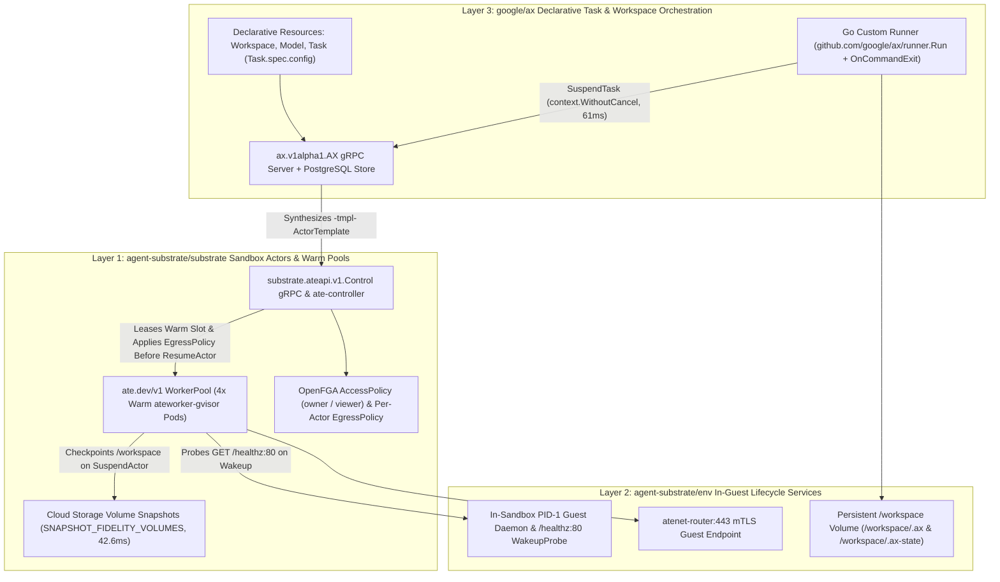
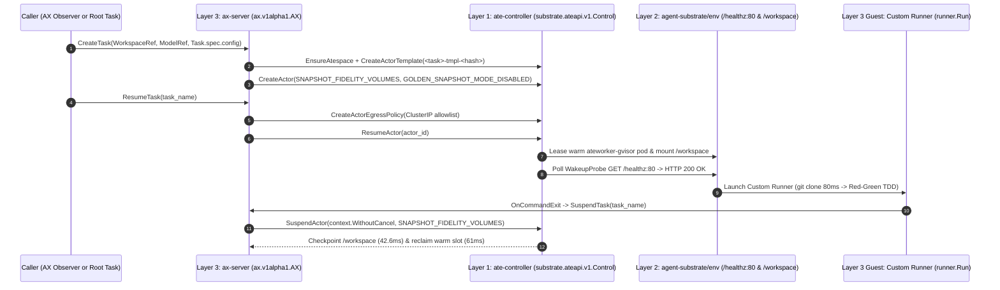

# BOM-19: The Three-Layer Agent Execution Architecture (`substrate`, `env`, and `google/ax` on GKE)

> [!IMPORTANT]
> - **Problem:** Platform engineers building agent systems on Kubernetes often conflate sandbox isolation (`agent-substrate/substrate`), in-guest lifecycle plumbing (`agent-substrate/env`), and declarative task orchestration (`google/ax`), making it unclear which API surface to target for a given workload.
> - **Approach:** This guide specifies the exact CRD, gRPC, and container-boundary contracts across all three layers of the **Three-Layer Substrate Stack** on Google Kubernetes Engine (GKE), backed by live empirical benchmarks from [`gke-demos/ax-bug-bash`](https://github.com/gke-demos/ax-bug-bash) and a 7-workload **Layer Selection Matrix**.
> - **Impact:** Teams can adopt Layer 1 alone (`substrate`), Layer 1 + Layer 2 (`substrate` + `env`), or the full three-layer stack (`substrate` + `env` + `google/ax` with a Go **Custom Runner**), achieving `80ms` workspace clones, `42.6ms` volume checkpoints, and `61ms` worker-slot reclamation on GKE.

[TOC]

## 1. Why the Agent Execution Stack Splits into Three Layers

Running autonomous coding and SRE agents in production requires solving three distinct infrastructure problems at different timescales and privilege levels:

1. **Kernel Isolation, Warm Compute Slots, and Zero-Trust Networking (Layer 1: `agent-substrate/substrate`)**: Untrusted model-generated code and CLI binaries need a hardened `gVisor` (`runsc`) kernel boundary, pre-warmed worker pods so tasks start in milliseconds without waiting for image pulls, sub-50ms volume snapshots to Cloud Storage when a task pauses, and fine-grained OpenFGA access and network egress policies.
2. **In-Guest Readiness, mTLS Tunnel Termination, and Volume Persistence (Layer 2: `agent-substrate/env`)**: Once a warm `gVisor` sandbox wakes up, the control plane needs an in-guest lifecycle daemon to signal when user-space processes and filesystem mounts are ready (`GET /healthz` on port `80`), terminate mutually authenticated `atenet-router:443` traffic, and preserve `/workspace` state across pause and resume cycles.
3. **Declarative Workspaces, Model Routing, and Recursive Task Trees (Layer 3: `google/ax`)**: Multi-step and multi-agent applications need a higher-level orchestrator that binds a Git `Workspace`, a zero-secret **Gemini Enterprise Agent Platform** (`Agent Platform`) `Model`, and an agent `Task` (with structured `Task.spec.config` payloads and `github.com/google/ax/runner.Run` lifecycle hooks) onto the underlying sandbox pool.

Coupling all three responsibilities into a single monolithic controller forces every user to adopt opinionated Git workspace and task-queue abstractions even when they only need a fast stateless code interpreter or a browser-attached PTY session. Separating the stack into three explicit layers lets each team stop at the lowest layer that satisfies its workload.



The sequence below traces how a single `CreateTask` + `ResumeTask` call traverses all three layers from `ax-server` down to the `ateworker-gvisor` sandbox and back during self-suspension:



## 2. Layer 1 (`agent-substrate/substrate`): Sandbox Actors, `WorkerPool`s, Volume Snapshots, OpenFGA, and Zero-Trust Egress

Layer 1 (`go.ate.dev/substrate/api/ateapi/v1`, gRPC service `substrate.ateapi.v1.Control`, and Kubernetes API group `ate.dev/v1`) manages the physical lifecycle of `gVisor`-isolated sandbox actors on GKE.

### Warm `WorkerPool` and Compute Obtainability

To eliminate container image pull and cold-start latency during bursty agent workloads, Layer 1 provides the `ate.dev/v1` `WorkerPool` Custom Resource Definition (CRD). A `WorkerPool` maintains a standing pool of pre-warmed `ateworker-gvisor` pods scheduled with `runtimeClassName: gvisor`:

```yaml
apiVersion: ate.dev/v1
kind: WorkerPool
metadata:
  name: ax-bug-bash-workers
  namespace: ax-bug-bash
spec:
  replicas: 4
  runtimeClassName: gvisor
  workerImage: us-central1-docker.pkg.dev/example-project/ax-bug-bash/ax-task-runner@sha256:494f1ef13a5a8f6a5649abfd8c32a90605531a1374f13bf2a973aa94f1585c01
  template:
    resources:
      requests:
        cpu: "1"
        memory: "2Gi"
```

When an agent task arrives, `ate-controller` binds the actor to an already-running `ateworker-gvisor` pod in milliseconds. When the task finishes its current turn, calling `SuspendActor` with `SNAPSHOT_FIDELITY_VOLUMES` checkpoints the `/workspace` volume to Cloud Storage in **`42.6ms`** (measured p50 on GKE) and immediately returns the `ateworker-gvisor` pod to the warm pool (`61ms` total slot reclamation). Designing for **compute obtainability** with warm `WorkerPool` slots and sub-100ms volume checkpoints allows 4 warm worker slots to serve dozens of concurrent multi-turn agent tasks without provisioning idle dedicated VMs.

### OpenFGA `AccessPolicy` and Zero-Trust `EgressPolicy`

Layer 1 enforces multi-tenant authorization and network segmentation outside the guest sandbox:

- **OpenFGA Relationship Tuples (`AccessPolicy`)**: Every `Atespace` and `Actor` operation is authorized against an OpenFGA store (`default`). Orchestrators that create and mutate actors require `role: owner` on the target namespace (`user:system:serviceaccount:ax-system:ax-server`), while observability dashboards such as the **AX Observer** (`user:system:serviceaccount:ax-bug-bash:ax-observer`) receive read-only `role: viewer` permissions to inspect live `ListActors` telemetry.
- **Per-Actor `EgressPolicy` (`atenet-egress`)**: By default, `ateworker-gvisor` sandboxes run under a default-deny egress posture. Before `ResumeActor` starts user code inside the sandbox, the control plane attaches a per-actor `EgressPolicy` specifying the exact ClusterIPs and TCP ports the actor may contact (such as `ax-server:8080`, `model-gateway:8080`, `storefront:3001`, and `storefront-git:8090`). Because `kube-dns` (`10.96.0.10:53`) sits outside the application service CIDR, resolving cluster services to concrete ClusterIPs when constructing the `EgressPolicy` guarantees zero DNS leakage from inside the untrusted guest.

## 3. Layer 2 (`agent-substrate/env`): In-Guest Lifecycle Daemon, Wakeup Probes, mTLS Tunnels, and Persistent Mounts

Layer 2 (`agent-substrate/env`) runs inside the `ateworker-gvisor` container boundary as the bridge between Layer 1's host-level `runsc` supervisor and the application or agent binary running inside the guest.

### The Layer 1 to Layer 2 Contract

1. **Readiness Handshake (`GET /healthz` on Port `80`)**: When `ate-controller` wakes a warm worker pod for an actor, it polls the actor's configured `WakeupProbe` over the internal sandbox network before marking the actor `Running` and routing traffic through `atenet-router:443`. In `agent-substrate/env`, the guest lifecycle daemon exposes `GET /healthz` on port `80`. Configuring `WakeupProbe.HttpGet.Path = "/healthz"` (documented in [`docs/upstream/google-ax-v060-patches.md`](../upstream/google-ax-v060-patches.md) under `google/ax` `Issue #482`) ensures `ResumeActor` completes as soon as the guest filesystem and network namespace are initialized.
2. **Volume-Only Snapshot Persistence (`/workspace` vs. Rootfs)**: Under `SNAPSHOT_FIDELITY_VOLUMES`, Layer 1 checkpoints and restores only the mounted `/workspace` volume across `SuspendActor` and `ResumeActor` transitions, while the container root filesystem (`/root`, `/tmp`, `/var`) resets to the clean `workerImage` layer on every wakeup. Any state that must survive across turns or across warm worker slots must live under `/workspace`.
3. **Pre-Warmed Toolchain Caches on Rootfs vs. Mutable Git State on `/workspace`**: Our `harnesses/Dockerfile.task-runner` image places read-only language toolchains and pre-warmed dependency caches (`GOCACHE`, Cargo registry, Python `venv`, and `node_modules`) on the container rootfs so they are instantaneously available in every warm slot, while keeping the mutable Git checkout (`/workspace`), the `google/ax` maiden-run marker (`/workspace/.ax`), and per-task execution state (`/workspace/.ax-state/<task-name>.json`, `google/ax` `Issue #518`) on the snapshotted `/workspace` volume.

## 4. Layer 3 (`google/ax`): Declarative `Workspace`, `Model`, `Task`, and `runner.Run` Orchestration

Layer 3 (`google/ax`, gRPC service `ax.v1alpha1.AX`, backed by PostgreSQL state storage in `internal/store/postgres/`) provides the developer-facing declarative API for multi-agent workflows.

### Declarative Resources and Live Substrate Projection

Instead of managing raw `ActorTemplate` and `Actor` protobufs directly, developers using Layer 3 declare three resources:

- **`Workspace`**: Points to a Git repository URL (such as `http://storefront.ax-bug-bash.svc.cluster.local:3001/git/storefront.git`). When a task starts, `github.com/google/ax/runner` clones or fetches the repository into `/workspace` in `80ms` over in-cluster Git Smart-HTTP.
- **`Model`**: Points to our zero-secret in-cluster **Gemini Enterprise Agent Platform** **Model Gateway** (`http://model-gateway.ax-system.svc.cluster.local:8080`), which holds the GKE Workload Identity binding outside the sandbox and executes an automatic 4-tier Gemini Flash fallback cascade (`gemini-3.8-flash` -> `gemini-3.7-flash` -> `gemini-3.6-flash` -> `gemini-3.5-flash`).
- **`Task` (`Task.spec.config`)**: Combines a `WorkspaceRef`, a `ModelRef`, an optional `parent_task` lineage pointer, and a free-form `google.protobuf.Struct` (`Task.spec.config`) carrying structured mission parameters (`role`, `incident_id`, `service`, `harness`, `failing_request`). On `CreateTask` and `ResumeTask`, `ax-server` synthesizes a deterministic `<task>-tmpl-<hash>` `ActorTemplate` and projects live actor status (`phase`, `workerIP`, `Ready`) directly from Layer 1 (`GetActor`/`ListActors`).

### Custom Runners (`github.com/google/ax/runner.Run`) and Recursive Task Fan-Out

Layer 3 includes a Go SDK (`github.com/google/ax/runner`) that lets teams replace the stock entrypoint with a domain-specific **Custom Runner** (`cmd/ax-bug-bash-runner/main.go`):

```go
err := runner.Run(ctx, runner.Options{
    OnCommandExit: func(runCtx context.Context, res runner.CommandResult) error {
        // 1. Verify Red-Green TDD regression test & git diff on refs/heads/fix/<task>
        // 2. Stream structured progress callback to AX Observer
        // 3. Immediately self-suspend to return the ateworker-gvisor slot to the WorkerPool
        return axClient.SuspendTask(runCtx, taskName)
    },
})
```

In **The Self-Spawning Bug Bash Tree**, a single Alertmanager webhook spawns a **Root Task** (`role = "root-triage"`). The **Root Task** queries Loki stack traces, identifies only the 2 to 3 implicated microservices, and acts as an in-cluster `ax.v1alpha1.AX` gRPC client to spawn parallel **Child Tasks** (`role = "child-fixer"`), each running **Antigravity** (`google-antigravity`), **OpenCode** (`opencode-ai`), or **Pi** (`@mariozechner/pi-coding-agent`). When each **Child Task** finishes its `REPRODUCE_RED` -> `PATCH_GREEN` cycle and pushes `refs/heads/fix/<task>`, its `OnCommandExit` hook calls `SuspendTask`. Inside `ax-server`, `Server.SuspendTask` detaches the gRPC context via `context.WithoutCancel(ctx)` (`google/ax` `Issue #511`) so `SuspendActor` finishes checkpointing `/workspace` even after the guest container's HTTP/2 stream closes.

## 5. The Layer Selection Matrix and Cross-Doc Mapping (`ate.dev`, `google/ax/docs/`, and Google Cloud Docs)

### The 7-Workload Layer Selection Matrix

Use the **Layer Selection Matrix** below to decide whether a new agent system should integrate directly with Layer 1 (`agent-substrate/substrate`), Layer 1 + Layer 2 (`substrate` + `env`), or the full three-layer stack (`substrate` + `env` + `google/ax`):

| Workload Pattern | Target Layers | Primary API / CRD Surface | State & Snapshot Model | Why Target This Layer |
| :--- | :--- | :--- | :--- | :--- |
| **1. High-Frequency Stateless Code Interpreter / Eval Grader** | **Layer 1 Only (`substrate`)** | `ate.dev/v1` `WorkerPool` + `substrate.ateapi.v1.Control` (`CreateActor`, `ResumeActor`, `DeleteActor`) | Ephemeral or `GOLDEN_SNAPSHOT_MODE` (`SNAPSHOT_FIDELITY_NONE`) | Lowest control-plane overhead when executing short-lived snippets that do not need Git workspace clones or model gateway routing. |
| **2. Custom Non-HTTP Guest Daemon / Binary Protocol Sandbox** | **Layer 1 Only (`substrate`)** | `ate.dev/v1` `WorkerPool` + custom TCP/HTTP `WakeupProbe` | Custom volume mount or ephemeral rootfs | Gives full control over PID-1 inside the `gVisor` sandbox when a workload uses a custom binary protocol instead of `agent-substrate/env`. |
| **3. Interactive Browser IDE / Per-User PTY Sandbox** (`learn-substrate` / `agentscope`) | **Layer 1 + Layer 2 (`substrate` + `env`)** | `substrate.ateapi.v1.Control` (`CreateActor`, `ResumeActor`, `SuspendActor`) + `atenet-router:443` WebSocket PTY & port preview | `SNAPSHOT_FIDELITY_VOLUMES` (`42.6ms` Cloud Storage checkpoint on idle timeout) | Maps 1:1 to a human developer's interactive browser session with `/healthz:80` readiness and instant idle pause/resume, without needing `ax` task queues. |
| **4. External Workflow Engine Step Runner** (Temporal / Cloud Workflows) | **Layer 1 + Layer 2 (`substrate` + `env`)** | External workflow worker calling `substrate.ateapi.v1.Control` + per-actor `EgressPolicy` | `SNAPSHOT_FIDELITY_VOLUMES` across workflow steps on `/workspace` | Keeps DAG state, retries, and human approval timers in the existing workflow engine while using `substrate` + `env` purely as a sub-100ms pausable `gVisor` execution environment. |
| **5. Single-Repo Autonomous Coding Task** (PR Fixer / Issue Triager) | **Full Three-Layer Stack (`substrate` + `env` + `ax`)** | `ax.v1alpha1.AX` (`Workspace`, `Model`, `Task`) with stock `ax-task-runner` | `/workspace/.ax` Git clone (`80ms`) + `SNAPSHOT_FIDELITY_VOLUMES` | Declarative `Workspace` and `Model` CRDs eliminate boilerplate for Git cloning, credential-free model routing, and multi-turn task persistence. |
| **6. Recursive Multi-Service Incident Response & Red-Green TDD Fan-Out** (`ax-bug-bash` **Bug Bash Tree**) | **Full Three-Layer Stack + Custom Runner (`substrate` + `env` + `ax` + `runner.Run`)** | `ax.v1alpha1.AX` (`CreateTask`/`ResumeTask` with `parent_task` & `Task.spec.config`) + Go `runner.Run` (`OnCommandExit` -> `SuspendTask`) | `/workspace/.ax` + isolated `/workspace/.ax-state/<task>.json` (`61ms` slot reclaim) | Enables a **Root Task** to dynamically spawn isolated **Child Tasks** per implicated microservice, enforce a branch verification gate, and auto-suspend workers on exit. |
| **7. Multi-Harness Comparative Evaluation Benchmark** (`antigravity`, `opencode`, `pi` in parallel) | **Full Three-Layer Stack + Custom Runner (`substrate` + `env` + `ax` + `runner.Run`)** | Shared `Workspace` & `Model` CRDs + parallel `Task` fan-out with `Task.spec.config.harness` | Warm `WorkerPool` slot reuse across `antigravity`, `opencode`, and `pi` runs | Evaluates multiple CLI **Coding Harnesses** side-by-side against identical polyglot incidents and **Gemini Enterprise Agent Platform** fallback cascades with `LIVE` vs. `FIXTURE` **Source Provenance**. |

### Cross-Repository Documentation Mapping (`ate.dev`, `google/ax/docs/`, and Google Cloud Docs)

To keep upstream CNCF documentation vendor-neutral while giving GKE users end-to-end production blueprints, the three-layer architecture maps across three documentation homes:

| Documentation Destination | Target Audience | Scope & Canonical Sections from This Guide |
| :--- | :--- | :--- |
| **1. Upstream CNCF `ate.dev` (`agent-substrate/substrate` & `agent-substrate/env`)** | Kubernetes platform engineers and sandbox integrators on any CNCF-conformant cluster | Vendor-neutral **Layer 1** (`ate.dev/v1` `WorkerPool`, `substrate.ateapi.v1.Control`, OpenFGA `AccessPolicy`, `EgressPolicy`, `SNAPSHOT_FIDELITY_VOLUMES`) and **Layer 2** (`agent-substrate/env` `/healthz:80` `WakeupProbe`, `atenet-router:443` mTLS, and `/workspace` volume semantics) from Sections 2, 3, and Rows 1 to 4 of the **Layer Selection Matrix**. |
| **2. Upstream `google/ax/docs/` (`docs/concepts.md` & `docs/runner.md`)** | Agent framework authors and Go developers building task graphs and custom runners | **Layer 3** declarative `Workspace`, `Model`, and `Task` (`Task.spec.config`) contracts, `github.com/google/ax/runner.Run` (`OnCommandExit` + `SuspendTask`), recursive `parent_task` fan-out from Section 4, Rows 5 to 7 of the **Layer Selection Matrix**, and the three upstream compatibility PR blueprints in [`docs/upstream/google-ax-v060-patches.md`](../upstream/google-ax-v060-patches.md). |
| **3. Google Cloud GKE & Gemini Enterprise Agent Platform Documentation** | Cloud architects running production agent fleets on GKE | GKE `gVisor` node pools and warm `WorkerPool` sizing for **compute obtainability**, GKE Workload Identity Federation for the zero-secret **Gemini Enterprise Agent Platform** **Model Gateway** (`gemini-3.8-flash` -> `3.7` -> `3.6` -> `3.5` cascade), Cloud Storage snapshot buckets, and dual-export observability to Google Cloud Logging and Google Cloud Managed Service for Prometheus. |
