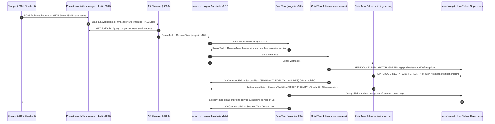
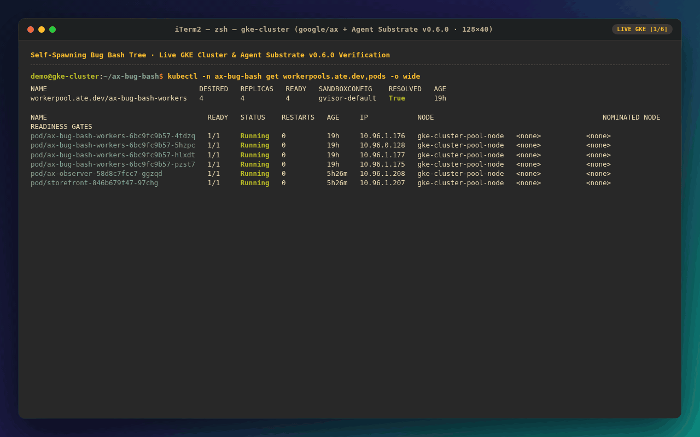
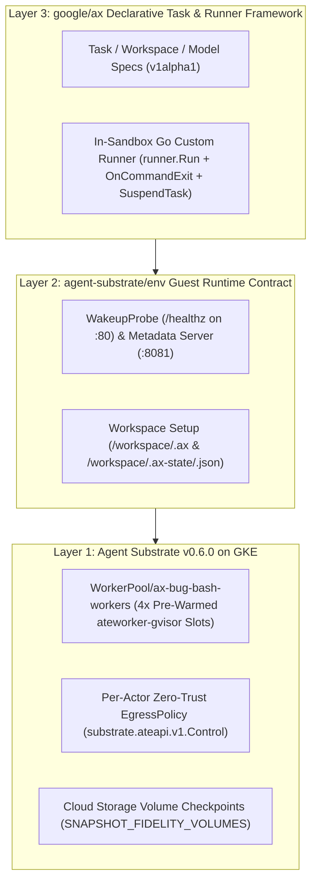

# Building a Self-Spawning Bug Bash Tree on google/ax and Agent Substrate v0.6.0

## 1. Why CI Passed and Production Still Returned HTTP 500

Every microservice in our five-service polyglot **Retail Storefront** passed its unit test suite before deployment. Running `./services/run-service-tests.sh --all` executes `npm test` on `storefront-web` (Node.js and TypeScript), `go test ./...` on `checkout-service` (Go) and `shipping-service` (Go), `python3 -m unittest` on `pricing-service` (Python and FastAPI), and `cargo test` on `inventory-service` (Rust and Axum). Every check reports green because each service tests its own happy path and single-parameter boundaries in isolation.

Production traffic crosses those boundaries in ways single-service unit tests miss. Consider what happens when a shopper submits a cart containing a $32.00 item and stacks two valid promotional codes, `SAVE20` (20% off) and `FLAT15` ($15.00 off), under **Incident Scenario** `INC-101` (Stacked Promo Negative Subtotal Crash):

```json
{
  "customer_id": "cust-inc-101",
  "currency": "USD",
  "promo_codes": ["SAVE20", "FLAT15"],
  "items": [
    {
      "sku": "ANALOG-SYNTH-CABLE",
      "name": "Braided Patch Cable Pack",
      "quantity": 1,
      "unit_price_cents": 3200,
      "weight_grams": 450,
      "hazmat_class": "NONE"
    }
  ]
}
```

When `checkout-service` forwards this cart to `pricing-service`, the Python discount engine applies `SAVE20` ($6.40 off) and `FLAT15` ($15.00 off) sequentially with an uncapped promotional rebate multiplier, driving `subtotal_cents` below zero to `-180`. Because the baseline unit tests in `services/pricing-service/test_pricing.py` only tested `SAVE20` and `FLAT15` individually on carts over $40.00, the missing zero floor never failed in CI. Next, `checkout-service` passes that negative subtotal to `shipping-service` (`POST /api/shipping/quote`). The Go rate calculator rejects negative subtotals with `NegativeSubtotalError` and returns `HTTP 500 Internal Server Error`.

A second scenario, `INC-102` (Flash-Sale Bundle `u32` Stock Underflow), fails across Rust and Go. When a flash-sale cart requests 3 units of a bundle with 2 bonus units (`bonus_bundle_units = 2`) against an inventory ledger holding 4 units, `inventory-service` in Rust computes `available_stock - (requested_qty + bonus_bundle_units)` using unsigned 32-bit integers (`4u32 - 5u32`). Checked arithmetic rejects the unsigned underflow, and `checkout-service` returns `HTTP 500`. Two additional scenarios complete the catalog: `INC-103` (Zero-Decimal `JPY` Currency Rounding Mismatch across TypeScript, Python, and Go) and `INC-104` (Lithium Hazmat Weight Tier Overflow at `3400g` across Rust and Go).

```text
level=ERROR service=pricing-service incident_id=INC-101 request_id=req-101-8f2a
msg="NegativeSubtotalError: stacked promos ['SAVE20', 'FLAT15'] produced subtotal_cents=-180 (< 0)"
file="services/pricing-service/pricing.py:74"

level=ERROR service=shipping-service incident_id=INC-101 request_id=req-101-8f2a
msg="ShippingRateError: cannot compute shipping tier for negative subtotal_cents=-180"
file="services/shipping-service/shipping.go:61"
```

Within 15 seconds of the first failing checkout on Surface 1 (`:3001` **Retail Storefront**), Surface 2 (`:3002` **Monitoring Stack**) catches the spike. Prometheus scrapes all five service `/metrics` endpoints every 5 seconds and evaluates `StorefrontHTTP500Spike` over a 3-sample `[15s]` window with `for: 0s`. Alertmanager groups the firing alert by `alertname` and dispatches a `POST /api/webhooks/alertmanager` webhook to Surface 3 (`:3000` **AX Observer**).

| Scenario ID | Title | Implicated Services | Unaffected Services | Root Failure Signature |
| :--- | :--- | :--- | :--- | :--- |
| `INC-101` | Stacked Promo Negative Subtotal Crash | `pricing-service` (Python), `shipping-service` (Go) | `storefront-web`, `checkout-service`, `inventory-service` | Unclamped stacked promo rebates produce `subtotal_cents < 0` |
| `INC-102` | Flash-Sale Bundle `u32` Stock Underflow | `inventory-service` (Rust), `checkout-service` (Go) | `storefront-web`, `shipping-service`, `pricing-service` | Unsigned `u32` subtraction underflows when `requested + bonus > stock` |
| `INC-103` | Zero-Decimal `JPY` Currency Rounding Mismatch | `storefront-web` (TS), `pricing-service` (Python), `checkout-service` (Go) | `shipping-service`, `inventory-service` | Fractional minor units on `JPY` trigger integer cent validation errors |
| `INC-104` | Lithium Hazmat Weight Tier Overflow | `inventory-service` (Rust), `shipping-service` (Go) | `storefront-web`, `checkout-service`, `pricing-service` | `UN3480-LITHIUM` parcels above `3000g` fall through exclusive `<` tier bounds |

## 2. From Single-Container Chat Loops to a Self-Spawning Bug Bash Tree

When an alert fires across a polyglot monorepo, a single-container coding loop has to clone the entire repository, read logs across all five services, run five separate test suites (`npm`, `go`, `unittest`, `cargo`), and edit files sequentially inside one context window. Context fills up with irrelevant compiler output from healthy services, and one slow test runner blocks repairs on the others.

In `ax-bug-bash`, the **AX Observer** responds to the Alertmanager v4 webhook by querying Loki (`GET /loki/api/v1/query_range`) for structured stack traces matching the incident window and dispatching a single **Root Task** (`triage-<id>`) to `ax-server` over gRPC (`ax.v1alpha1.AX/CreateTask` followed by `ResumeTask`).

The **Root Task** runs inside a warm `ateworker-gvisor` sandbox with `Task.spec.config.role = "root-triage"`. It inspects the Alertmanager labels and Loki stack traces, maps the fault to the exact 2 to 3 implicated microservices, and leaves the remaining unaffected services untouched. For `INC-101`, the **Root Task** isolates `pricing-service` and `shipping-service` while skipping `storefront-web`, `checkout-service`, and `inventory-service`. It then acts as a gRPC client to `ax-server`, calling `CreateTask` and `ResumeTask` in parallel to spawn one isolated **Child Task** (`fixer-<id>-<service>`) per implicated microservice.



Each **Child Task** receives a scoped mission payload in `Task.spec.config`, checks out the monorepo from the in-cluster Git server in `80ms`, writes a failing **Regression Test** that reproduces the exact production error (`REPRODUCE_RED`), patches only its assigned service directory until its language test suite passes (`PATCH_GREEN`), pushes `refs/heads/fix/<task-name>`, and auto-suspends so the worker pool immediately reclaims its gVisor sandbox slot.

The live terminal recording below (`docs/assets/ax-live-gke-terminal.gif`) captures this full cycle against a live GKE cluster running Agent Substrate `v0.6.0` and `google/ax`:



## 3. The Three-Layer Substrate Stack on GKE (`BOM-19` and `BOM-20`)

Running a self-spawning **Bug Bash Tree** in production requires coordinating low-level kernel sandboxes, container filesystems, and high-level agent task APIs. The architecture builds on the **Three-Layer Substrate Stack**, which separates sandbox virtualization from guest lifecycle conventions and declarative task orchestration:



### Layer 1: `Agent Substrate v0.6.0` (`ate.dev/v1` and `substrate.ateapi.v1.Control`)

Layer 1 provides the sandboxed compute plane on GKE. `manifests/ax-v060-overlay.yaml` declares a 4-replica `WorkerPool` named `ax-bug-bash-workers` backed by the `ateworker-gvisor` runtime (`SandboxConfig/gvisor-default`) and OpenFGA `AccessPolicy` bindings:

```yaml
apiVersion: ate.dev/v1
kind: WorkerPool
metadata:
  name: ax-bug-bash-workers
  namespace: ax-bug-bash
  annotations:
    ax.dev/worker-runtime: "ateworker-gvisor"
    ax.dev/snapshot-fidelity: "SNAPSHOT_FIDELITY_VOLUMES"
spec:
  replicas: 4
  workerImage: ${ATEWORKER_GVISOR_IMAGE}
  sandboxClasses:
    - name: gvisor
      configRef:
        name: gvisor-default
```

Three implementation details at Layer 1 proved essential during live GKE verification:

1. **OpenFGA `AccessPolicy` Tuples**: `ax-server` authenticates as `user:system:serviceaccount:ax-system:ax-server` with `role: owner` so it can create Atespaces and actors, while `ax-observer` runs as `user:system:serviceaccount:ax-bug-bash:ax-observer` with read-only `role: viewer` to stream live worker slot telemetry (`GET /api/workers`) without holding task mutation privileges.
2. **Per-Actor Zero-Trust `EgressPolicy` Before `ResumeActor`**: By default, an `ateworker-gvisor` sandbox denies outbound network traffic once `atenet-egress` initializes. Furthermore, gVisor sandboxes resolve cluster DNS via `kube-dns` (`10.96.0.10:53`), which sits outside the pod CIDR. Our `ax-server` overlay attaches a per-actor `EgressPolicy` via `CreateActorEgressPolicy` immediately after `CreateActor` and before `ResumeActor`, allowlisting only the internal `ax-server`, `model-gateway`, `storefront-git`, `ax-observer`, and `loki` service endpoints and ports.
3. **Detached Context on Self-Suspension (`SNAPSHOT_FIDELITY_VOLUMES`)**: When an in-sandbox runner calls `SuspendTask` on itself upon completion, `runsc` tears down the sandbox network namespace while the gRPC request is still in flight. Wrapping `SuspendTask` in `context.WithoutCancel(ctx)` inside `ax-server` prevents caller stream teardown from aborting `SuspendActor` mid-checkpoint, allowing Cloud Storage volume snapshots (`SNAPSHOT_FIDELITY_VOLUMES`) to finish in `42.6ms`.

### Layer 2: `agent-substrate/env` (Guest Probes and Volume-Backed State)

Layer 2 defines how the container guest inside `ateworker-gvisor` communicates readiness and persists workspace state across suspend and resume cycles:

- **Immediate `/healthz` Wakeup Probe**: If the actor `WakeupProbe` points to `/readyz`, `runner.Run` blocks `/readyz` until `workspace.SetupWorkspace` finishes cloning the Git repository, while `atenet-egress` waits for the wakeup probe before activating the actor's `EgressPolicy`. Pointing `WakeupProbe` to `/healthz` on port `80` breaks that deadlock so egress rules activate first and the Smart-HTTP `git clone` from `storefront-git` completes in `80ms`.
- **Volume-Persisted `.ax` and `.ax-state` Directories**: Because `SNAPSHOT_FIDELITY_VOLUMES` snapshots only `/workspace`, placing `.ax` or task state on the root filesystem (`/root/.ax`) loses state across `SuspendTask` and `ResumeTask`. Setting `workspace.AXDir = "/workspace/.ax"` and writing structured task checkpoints to `/workspace/.ax-state/<task-name>.json` makes every task idempotent across restarts.

### Layer 3: `google/ax` (`Task`, `Workspace`, `Model`, and `Custom Runner`)

Layer 3 provides the declarative `v1alpha1` API (`Task`, `Workspace`, `Model`) and the in-sandbox Go `runner` library (`github.com/google/ax/runner`). The **Root Task** passes per-service failure context to each **Child Task** through the free-form `Task.spec.config` (`google.protobuf.Struct`) field (`internal/bugbash/triage.go`):

```go
cfgStruct, err := structpb.NewStruct(map[string]any{
	"role":                 "child-fixer",
	"parent_task":          rootTaskName,
	"incident_id":          spec.IncidentID,
	"service":              spec.Service,
	"language":             spec.Language,
	"harness":              spec.Harness,
	"requested_model":      spec.RequestedModel,
	"source_file":          spec.SourceFile,
	"test_file":            spec.TestFile,
	"regression_test_name": spec.RegressionTestName,
	"error_message":        spec.ErrorMessage,
	"stack_trace":          spec.StackTrace,
	"failing_request":      spec.FailingRequest,
})
```

Inside each sandbox, `cmd/ax-bug-bash-runner` embeds `runner.Run` (`internal/bugbash/runner.go`). When the supervised `--execute-task` child process exits, the `OnCommandExit` hook captures the unified Git diff, writes `/workspace/.ax-state/<task-name>.json`, posts a real-time `child.completed` event to the **AX Observer**, and calls `ax.v1alpha1.AX/SuspendTask` to release the warm worker slot:

```go
cfg := runner.Config{
	Port:         opts.Port,
	MetadataPort: opts.MetadataPort,
	Task:         task,
	Workspace:    ws,
	OnCommandExit: func(exit runner.CommandExit) {
		res, _ := LoadTaskStateSnapshot(wsPath, taskName)
		if res.UnifiedGitDiff == "" {
			res.UnifiedGitDiff = CaptureWorkspaceGitDiff(wsPath, "")
		}
		res.ExitCode = exit.ExitCode
		res.Suspended = true
		res.SuspendedAt = time.Now().UTC()
		_ = SaveTaskStateSnapshot(wsPath, res)
		if axServerAddr != "" {
			_ = suspendTaskViaGRPC(axServerAddr, atespace, taskName)
		}
	},
}
return runner.Run(runCtx, cfg)
```

## 4. Multi-Harness Red-Green TDD and the Zero-Secret Model Gateway

Different engineering teams standardize on different CLI coding agents. Rather than hardcoding a single agent binary, `harnesses/Dockerfile.task-runner` pre-installs three CLI **Coding Harnesses** inside the task-runner image alongside pre-warmed Go (`GOCACHE`), Rust (`cargo`), Python, and Node.js build caches:

1. **Antigravity (`antigravity`)**: `google-antigravity`, speaking the native Gemini REST protocol (`/s/{task_name}/v1beta/models/{model}:generateContent`).
2. **OpenCode (`opencode`)**: `opencode-ai`, speaking OpenAI-compatible chat completions (`/s/{task_name}/v1/chat/completions`).
3. **Pi (`pi`)**: `@mariozechner/pi-coding-agent`, speaking OpenAI-compatible chat completions (`/s/{task_name}/v1/chat/completions`).

When a **Bug Bash Tree** runs in `multi` mode, the **Root Task** assigns different harnesses across sibling **Child Tasks** in parallel so `fixer-inc-101-pricing-service` runs under **Antigravity** while `fixer-inc-101-shipping-service` runs under **OpenCode** (and a third implicated service in `INC-103` runs under **Pi**).

Every **Child Task** enforces a strict two-phase Red-Green TDD contract (`internal/bugbash/live_sandbox.go`):

- **Phase 1 (`REPRODUCE_RED`)**: The **Child Task** invokes its assigned **Coding Harness** to author a new unit test named `mission.RegressionTestName` (for example, `test_stacked_promo_negative_subtotal_floor` in `services/pricing-service/test_pricing.py`) using the exact `failing_request` payload from the production incident. Before running the service test runner, the sandbox restores the baseline production source file to guarantee the model did not prematurely patch production code during the Red step. The step passes only if the test file changed and the service test suite fails on the new test.
- **Phase 2 (`PATCH_GREEN`)**: The **Child Task** invokes the **Coding Harness** to patch `detail.SourceFile` (for example, clamping `subtotal_cents = max(0, subtotal_cents)` in `services/pricing-service/pricing.py`) while keeping the new regression test intact. The step passes only when the full language test suite exits `0`.

### Zero-Secret Credentials and Designing for Compute Obtainability

Sandboxes executing untrusted or generated code should never hold Google Cloud service account keys or raw OAuth2 access tokens. Inside `ateworker-gvisor`, each harness receives a placeholder credential (`ax-sandbox-token`) and points its base URL at the cluster-internal **Model Gateway** (`http://model-gateway.ax-system.svc.cluster.local:8080/s/{task_name}`).

The **Model Gateway** (`internal/gateway/gateway.go` and `internal/gateway/cascade.go`) runs in `ax-system` and authenticates to **Gemini Enterprise Agent Platform** using GKE Workload Identity (`http://metadata.google.internal/computeMetadata/v1/instance/service-accounts/default/token`). To design for **compute obtainability** during regional traffic bursts or quota spikes, the gateway implements an automatic 4-tier Gemini Flash fallback cascade:

```go
// DefaultFallbackCascade defines the canonical ADR-0007 ordered Gemini Flash fallback cascade.
var DefaultFallbackCascade = []string{
	"gemini-3.8-flash",
	"gemini-3.7-flash",
	"gemini-3.6-flash",
	"gemini-3.5-flash",
}
```

When a **Coding Harness** sends a request for `gemini-3.8-flash` (either via native Gemini `generateContent` or translated from OpenAI `/v1/chat/completions`), `ExecuteGeminiCascade` attempts each tier in order (`gemini-3.8-flash` -> `gemini-3.7-flash` -> `gemini-3.6-flash` -> `gemini-3.5-flash`). If an upstream endpoint returns `429 Too Many Requests`, `503 Service Unavailable`, or a transient `5xx` error, `ShouldFallback` immediately retries the next Flash model in the cascade and records the attempt trace (`X-AX-Active-Model`, `X-AX-Source-Provenance: LIVE`, and `X-AX-Cascade-Attempts`). For offline CI runs where cloud credentials are absent, the gateway can synthesize deterministic `<file path="...">` responses tagged with `SourceProvenance: FIXTURE`, while live GKE evaluations fail closed if any task falls back to `FIXTURE`.

## 5. Root Verification Gate and Sub-3-Second Selective Git Hot-Reload

Once a **Child Task** passes `PATCH_GREEN`, it stages only `services/<service>` (explicitly excluding `/workspace/.ax` and `/workspace/.ax-state` so runtime metadata never pollutes Git history) and pushes its branch (`HEAD:refs/heads/fix/<task-name>`) to the in-cluster `storefront-git` Smart-HTTP server.

The **Root Task** does not blindly trust child callbacks. Inside `ExecuteSandboxRootTask` (`internal/bugbash/live_sandbox.go`), the **Root Task** fetches each child branch (`refs/heads/fix/<task-name>`), verifies that every modified file path stays strictly within `services/<implicated-service>/`, merges the verified branches into `main` with `git merge --no-ff`, re-runs the test suites across the merged workspace, and pushes the heal commit to `origin/main`.

Pushing to `storefront-git` triggers the post-receive hook in `internal/storefront/gitserver.go`. Rather than restarting all five Kubernetes `Deployment`s and waiting 30 to 60 seconds for container image rebuilds and pod scheduling, `storefront-git` computes `git diff --name-only <oldRev> <newRev>` and sends `POST /internal/reload` only to the **Hot-Reload Supervisor** instances whose `services/<service>/` directory actually changed.

Each microservice pod runs `cmd/polyglot-supervisor` (`internal/supervisor/supervisor.go`) as PID 1. The **Hot-Reload Supervisor** owns the service's public port and persistent Prometheus counters (`storefront_http_requests_total` and `storefront_service_reloads_total`), while proxying live traffic to a loopback child process:

```go
candidate := &runningChild{
	commitSHA: commitSHA,
	port:      port,
	stageDir:  stageDir,
	cmd:       cmd,
	doneCh:    doneCh,
	proxy:     proxy,
}

prev := s.activeChild.Swap(candidate)
durMs := time.Since(start).Milliseconds()
s.lastReloadDurationMs.Store(durMs)
s.reloadCount.Add(1)
```

When `Reload(ctx, "refs/heads/main")` runs on an implicated service, the supervisor checks out the new commit into a staging directory, builds against the container's pre-warmed toolchain cache (`GOCACHE`, `cargo` target cache, Python bytecode, or Node modules), boots the new child server on an ephemeral loopback port, waits for `/healthz` to return `200 OK`, and executes an atomic pointer swap (`s.activeChild.Swap(candidate)`). In-flight requests on the previous child process drain cleanly via `old.inFlight.Wait()`, and unaffected services receive zero reload requests and drop zero connections.

## 6. Live GKE Benchmarks and Two-Tier Evaluation

We measured every stage of the **Bug Bash Tree** lifecycle on a live GKE cluster running Agent Substrate `v0.6.0` (`4/4 Ready` `ateworker-gvisor` pods in `WorkerPool/ax-bug-bash-workers`). The table below summarizes the observed latencies across the stack:

| Lifecycle Operation | Measured GKE Latency | Architectural Mechanism |
| :--- | :--- | :--- |
| In-sandbox Smart-HTTP `git clone` | `80ms` | Cluster-internal `storefront-git` service + `/healthz` `WakeupProbe` |
| Pre-warmed in-sandbox `go test` execution | `4ms` | Pre-baked `GOCACHE` and module cache inside `Dockerfile.task-runner` |
| Cloud Storage volume checkpoint (`SuspendTask`) | `42.6ms` | `SNAPSHOT_FIDELITY_VOLUMES` on `/workspace` (`GOLDEN_SNAPSHOT_MODE_DISABLED`) |
| `OnCommandExit` to `SuspendTask` slot reclamation | `61ms` | Detached `context.WithoutCancel(ctx)` in `ax-server` `SuspendTask` |
| Selective polyglot hot-reload (`Node.js`, `Python`, `Go`) | `820ms` to `1.5s` | PID-1 **Hot-Reload Supervisor** atomic loopback swap (`s.activeChild.Swap`) |
| Selective Rust (`inventory-service`) hot-reload | `2.8s` to `4.2s` | Incremental `cargo build` against pre-warmed `/var/cache/ax-bug-bash/cargo-target` |
| End-to-end multi-service incident heal (`LIVE_GKE`) | `18s` to `34s` | Alertmanager webhook -> Root Triage -> Parallel Child Red-Green TDD -> Git merge & hot-reload |

### Two-Tier Evaluation (`make eval` vs. `make eval-live-gke`)

To keep day-to-day inner-loop development fast while holding the live GKE deployment to strict production invariants, the repository splits verification into a two-tier evaluation suite (`internal/evals/evals.go` and `internal/evals/live_gke_eval.go`):

1. **Tier 1 Hermetic Evaluation Matrix (`make eval`, `< 60s`)**: Runs 20 concurrent trajectories at `MaxConcurrency = 4` without requiring a Kubernetes cluster. That matrix covers all 16 combinations of the 4 **Incident Scenarios** (`INC-101` through `INC-104`) across all 4 harness modes (`antigravity`, `opencode`, `pi`, and `multi`), plus 4 `LIVE` cascade failover trajectories that simulate upstream `429` and `503` responses across `gemini-3.8-flash`, `gemini-3.7-flash`, `gemini-3.6-flash`, and `gemini-3.5-flash`. It also runs `VerifyRepositoryHygieneAndManifests` and `VerifyArchitectureCatalogDrift` to verify `@sha256:` image digest pinning, `/about` **Architecture Topology Catalog** consistency, and prose hygiene.
2. **Tier 2 Live-GKE 4x4 Chaos Soak and Dual-Export Verifier (`make eval-live-gke`)**: Executes a sequential (`MaxConcurrency = 1`) chaos soak (`INC-101` on `antigravity`, `INC-102` on `opencode`, `INC-103` on `pi`, and `INC-104` on `multi`) against a live GKE cluster. Every trajectory must execute real `ateworker-gvisor` sandboxes with `SourceProvenance == "LIVE"` (failing closed if any child task uses `FIXTURE`), reclaim all 4 warm worker slots (`AllocatedSlots == 0`) after `SuspendTask`, reset `storefront-git` to `baseline-v1`, and drain `StorefrontHTTP500Spike` in Prometheus (`/api/v1/alerts`) before the next incident begins. Finally, `VerifyGCPDualExport` queries the Google Cloud Logging v2 API (`entries:list`) and Google Cloud Managed Service for Prometheus v3 API (`timeSeries` for `prometheus.googleapis.com/storefront_http_requests_total/counter`) with `X-Goog-User-Project` headers and writes a stage-safe scrubbed report (`0600`) to `/tmp/ax-live-gke-eval-report.json`.

Every trajectory in both tiers is graded against the same six core invariants:

1. `BaselineCIGreen`: All five microservices pass their baseline unit tests before the incident activates.
2. `AlertmanagerWebhookTriggered`: Submitting the trigger cart causes `POST /api/cart/checkout` to return `HTTP 500`, increments Prometheus 500 counters, and fires an Alertmanager webhook enriched with Loki stack traces.
3. `SelectiveBlastRadiusFanOut`: The **Root Task** spawns **Child Tasks** only for the 2 to 3 implicated services.
4. `RedGreenRegressionTDD`: Every **Child Task** records a failing `REPRODUCE_RED` test before patching the service in `PATCH_GREEN`.
5. `OnCommandExitAndSuspendReclaimed`: Every task captures its `UnifiedGitDiff`, persists `/workspace/.ax-state/<task-name>.json` under `SNAPSHOT_FIDELITY_VOLUMES`, calls `SuspendTask`, and returns its worker slot to `Ready (Warm)`.
6. `PreWarmedRolloutAndStorefrontHealed`: Merging into `main` reloads only the modified services in under 10 seconds and replays the checkout cart to confirm `HTTP 200 CONFIRMED`.

## 7. Try It Yourself

You can run the entire three-surface **Bug Bash Tree** locally in hermetic `SIMULATED` mode or deploy the full stack onto a GKE cluster with Agent Substrate `v0.6.0`:

```bash
# 1. Start all 3 decoupled surfaces locally (:3000 AX Observer, :3001 Storefront, :3002 Monitoring)
make run-local

# 2. Run the 20-trajectory hermetic evaluation suite and manifest hygiene checks
make eval

# 3. Deploy to your active GKE cluster context (kubectl config current-context)
make deploy

# 4. Run the sequential live GKE 4x4 chaos soak and GCP dual-export verifier
make eval-live-gke
```

For a step-by-step walkthrough covering local simulation, writing a Go **Custom Runner** with `github.com/google/ax/runner.Run`, configuring the zero-secret **Model Gateway** fallback cascade, deploying to GKE, and inspecting the live chaos soak telemetry, follow our five-lab developer tutorial in [`docs/tutorial/build-a-self-spawning-bug-bash-tree.md`](../tutorial/build-a-self-spawning-bug-bash-tree.md).
