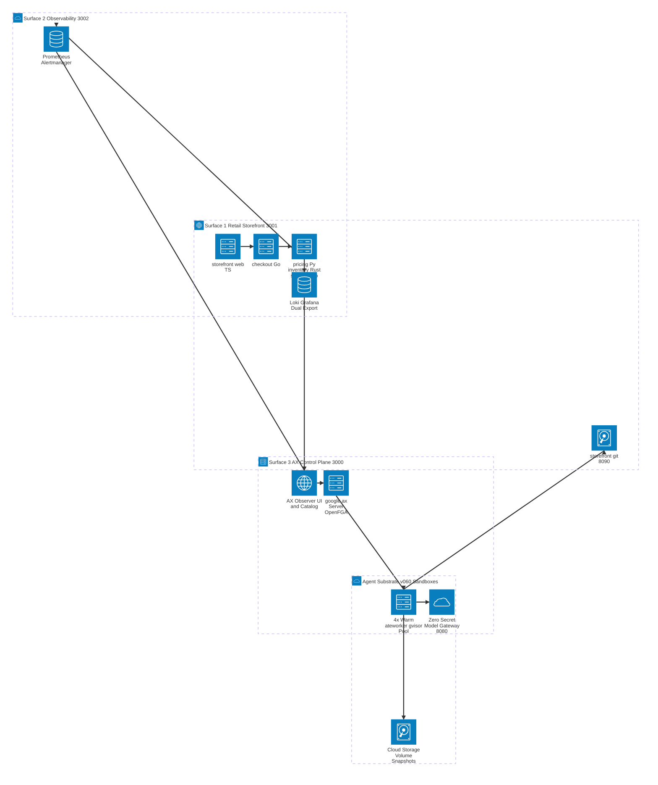
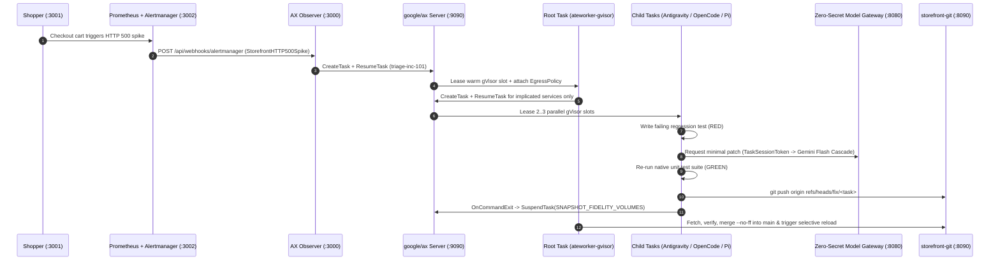
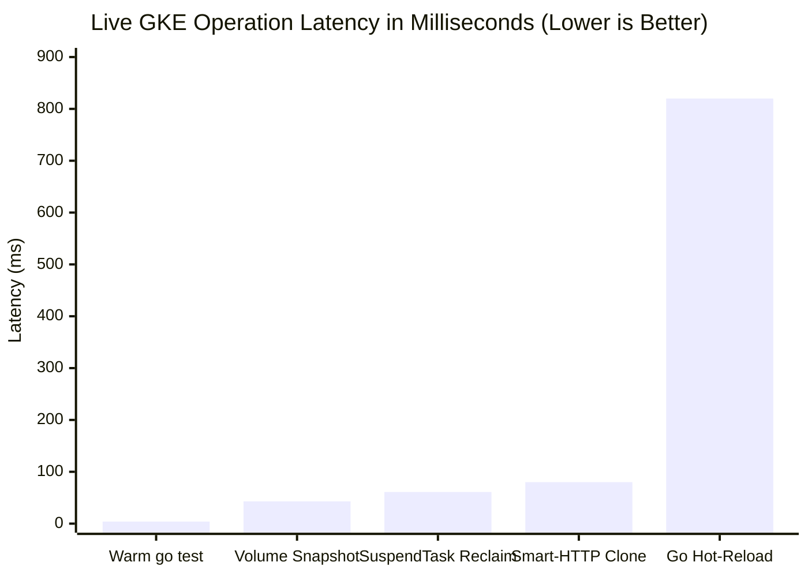

# The Self-Spawning Bug Bash Tree: Architecture, Upstream google/ax Overlay & Live-GKE Evaluation Report

> [!IMPORTANT]
> - **Problem:** Single-service CI tests pass on happy-path inputs while subtle multi-service edge cases trigger production HTTP 500 spikes across polyglot microservices.
> - **Approach:** An event-driven **Root Task** on `google/ax` and **Agent Substrate `v0.6.0`** correlates Alertmanager and Loki stack traces and dynamically spawns isolated **Child Tasks** across warm `ateworker-gvisor` sandboxes to run Red-Green TDD.
> - **Impact:** Heals 4 cross-service production incidents across 5 languages in **`820ms to 4.2s`** selective Git hot-reload, with **`42.6ms`** Cloud Storage volume checkpoints and **`61ms`** worker-slot reclamation.

[TOC]

## 1. Executive Summary & Three Decoupled Surfaces

`ax-bug-bash` (*The Self-Spawning Bug Bash Tree*) is the flagship reference implementation for **BOM-19** (*Three-layer architecture guide for `substrate`, `env`, and `ax`*) and **BOM-20** (*Declarative workspaces, goal bootstrap, and custom `ax-task-runner` blog and tutorial*). Instead of embedding a mock target inside a chat window, the system runs as three independent, browser-accessible production surfaces on Google Kubernetes Engine (GKE):

| Surface | Default Endpoint | Core Responsibilities |
| :--- | :--- | :--- |
| **1. Retail Storefront** | `http://localhost:3001` | 5 real microservices (`storefront-web` in Node.js/TypeScript, `checkout-service` in Go, `shipping-service` in Go, `pricing-service` in Python/FastAPI, `inventory-service` in Rust/Axum) backed by an in-cluster Git Smart-HTTP server (`/git/storefront.git`) and a PID-1 **Hot-Reload Supervisor**. |
| **2. Observability Stack** | `http://localhost:3002` | In-cluster Prometheus (`5s` scrape / `[15s]` evaluation window), Alertmanager v4 webhook dispatcher, Loki LogQL stack trace ingestion, pre-provisioned Grafana (`ax-bug-bash-storefront`), and dual-export to Google Cloud Managed Service for Prometheus and Cloud Logging. |
| **3. AX Observer** | `http://localhost:3000` | Clean web UI with path-based routing (`/`, `/workers`, `/about`), a 3-tab interactive SVG **Architecture Topology Catalog** (`GET /api/about/catalog` verifying `ADR-0001` through `ADR-0013`), an icon-only Sun/Moon **Projector Light Mode** toggle, and a `Cmd+K` Scenario & Harness Launcher. |

## 2. The Three-Layer Substrate Stack (`BOM-19`)

Building a self-spawning agent tree on GKE relies on three composable open-source layers:

| Layer | Repository & API | Role in the Self-Spawning Bug Bash Tree |
| :--- | :--- | :--- |
| **Layer 3: Orchestration** | `google/ax` (`ax.v1alpha1.AX` gRPC + `github.com/google/ax/runner`) | Manages declarative `Task`, `Workspace` (`storefront-monorepo`), and `Model` (`gemini-flash-cascade`) resources, passes structured JSON missions via `Task.spec.config` (`google.protobuf.Struct`), and executes the in-sandbox Go **Custom Runner** (`runner.Run`). |
| **Layer 2: Guest Runtime** | `agent-substrate/env` (`/healthz:80` + workspace hooks) | Exposes the container readiness endpoint (`/healthz` on port `80`), runs `workspace.SetupWorkspace` against the persistent `/workspace/.ax` maiden-run marker, and preserves per-task state under `/workspace/.ax-state/<task-name>.json`. |
| **Layer 1: Sandbox Kernel** | `agent-substrate/substrate` (`ate.dev/v1` `WorkerPool` + `substrate.ateapi.v1.Control`) | Maintains 4 pre-warmed `ateworker-gvisor` sandbox pods, enforces per-actor zero-trust `EgressPolicy` rules, and checkpoints `/workspace` volumes to Cloud Storage via `SNAPSHOT_FIDELITY_VOLUMES`. |

## 3. Four Multi-Service Incident Scenarios & Selective Blast Radius

Every microservice passes its baseline unit test suite (`./services/run-service-tests.sh --all`) before an incident is triggered. When an incident fires, the **Root Task** inspects the correlated Loki LogQL stack traces and fans out **Child Tasks** strictly for the 2 to 3 implicated services:

| Incident ID | Failure Scenario | Implicated Services (Spawned Child Tasks) | Unaffected Services (Untouched) | Root Cause & TDD Fix |
| :--- | :--- | :--- | :--- | :--- |
| **`INC-101`** | **Stacked Promo Negative Subtotal Crash** | `pricing-service` (Python), `shipping-service` (Go) | `storefront-web`, `checkout-service`, `inventory-service` | Stacking `SAVE20` (`20%`) and `FLAT15` (`$15.00`) on a `$16.00` USB-C cable (`sku-cable-usbc`) drives subtotal to `-220` cents. Child Tasks clamp subtotal floor to `0` in Python and guard negative subtotals in Go shipping calculation. |
| **`INC-102`** | **Flash-Sale Bundle `u32` Underflow** | `inventory-service` (Rust), `checkout-service` (Go) | `storefront-web`, `shipping-service`, `pricing-service` | Ordering `sku-mechanical-kb-bundle` with `bonus_bundle_units=3` when `available=4` underflows unsigned `u32` subtraction in Rust (`available - total_required`). Child Tasks use checked arithmetic and propagate `409 Conflict` in Go. |
| **`INC-103`** | **Zero-Decimal `JPY` Currency Rounding** | `storefront-web` (TypeScript), `pricing-service` (Python), `checkout-service` (Go) | `shipping-service`, `inventory-service` | Percentage discount on a `JPY` cart produces fractional minor units (`4476.15`). Child Tasks enforce currency-aware integer rounding (`Math.round` / `round()`) across TypeScript, Python, and Go. |
| **`INC-104`** | **Lithium Hazmat Weight Tier Overflow** | `inventory-service` (Rust), `shipping-service` (Go) | `storefront-web`, `checkout-service`, `pricing-service` | Regulated `UN3480-LITHIUM` power station parcel at `3,400g` hits an unhandled ground hazmat weight tier. Child Tasks add the heavy-lithium ground surcharge tier in Rust and Go. |

## 4. Zero-Secret Model Gateway & Compute Obtainability (`ADR-0007`)

Sandboxes running untrusted or LLM-generated code never receive Google Cloud service account keys or long-lived API tokens. Instead, each **Child Task** authenticates to the in-cluster **Model Gateway** (`http://model-gateway.ax-system.svc.cluster.local:8080`) using a short-lived, task-scoped `TaskSessionToken`.

To design for **compute obtainability** across regions and quota tiers on **Gemini Enterprise Agent Platform**, the gateway implements an automatic 4-tier Gemini Flash fallback cascade for all three pre-baked CLI harnesses (**Antigravity**, **OpenCode**, and **Pi**):

| Cascade Tier | Model Identifier | Wire Protocols Supported | Automatic Failover Condition |
| :--- | :--- | :--- | :--- |
| **Tier 1 (Primary)** | `gemini-3.8-flash` | Gemini `v1beta` (`:generateContent`) & OpenAI `v1/chat/completions` | Default tier (`0ms` initial backoff) |
| **Tier 2 (Secondary)** | `gemini-3.7-flash` | Gemini `v1beta` & OpenAI `v1/chat/completions` | HTTP `429 TooManyRequests` or `503 ServiceUnavailable` on Tier 1 |
| **Tier 3 (Tertiary)** | `gemini-3.6-flash` | Gemini `v1beta` & OpenAI `v1/chat/completions` | Quota exhaustion or upstream deadline exceeded on Tier 2 |
| **Tier 4 (Floor)** | `gemini-3.5-flash` | Gemini `v1beta` & OpenAI `v1/chat/completions` | Regional capacity overflow on Tier 3 (plus deterministic `FIXTURE` fallback in offline CI) |

## 5. Upstream `google/ax` Compatibility Overlay (`ADR-0013`)

Running `google/ax` (`4b7bf6f`) against **Agent Substrate `v0.6.1`** (`substrate.ateapi.v1.Control`) on a live GKE cluster surfaced three cross-layer lifecycle issues. We packaged the fixes as a clean, reproducible patch in [`deploy/ax-server/ax-server-v061.patch`](https://github.com/gke-demos/ax-bug-bash/blob/main/deploy/ax-server/ax-server-v061.patch) and documented three standalone upstream PR blueprints in [`docs/upstream/google-ax-v060-patches.md`](https://github.com/gke-demos/ax-bug-bash/blob/main/docs/upstream/google-ax-v060-patches.md):

| Upstream Issue | Root Cause in Upstream `google/ax` (`4b7bf6f`) | Overlay Fix in `deploy/ax-server/ax-server-v061.patch` |
| :--- | :--- | :--- |
| **[Issue #482](https://github.com/google/ax/issues/482)** | `WakeupProbe` probes `/readyz:80` while `agent-substrate/env` serves `/healthz:80`; `GoldenSnapshotConfig` defaults to enabled; no per-actor `EgressPolicy` exists before `ResumeActor` runs `git clone`. | Probe `/healthz:80`, set `GOLDEN_SNAPSHOT_MODE_DISABLED`, and invoke `ensureActorEgressPolicy` (`AX_AUTO_ACTOR_EGRESS=true`) before `ResumeActor`. |
| **[Issue #511](https://github.com/google/ax/issues/511)** | Agent Substrate `v0.6.1` moved protos to `go.ate.dev/substrate/api/ateapi/v1`; `Server.SuspendTask` uses caller request `ctx`, which cancels mid-checkpoint when `runsc` stops the caller container. | Update proto imports to `api/ateapi/v1`, seed OpenFGA `default` store + `AccessPolicy`, and wrap `Server.SuspendTask` in `context.WithTimeout(context.WithoutCancel(ctx), 30*time.Second)`. |
| **[Issue #518](https://github.com/google/ax/issues/518)** | `workspace.DefaultAXDir` (`/root/.ax`) lives on the ephemeral rootfs and disappears across `SNAPSHOT_FIDELITY_VOLUMES` restores; parallel tasks collide on shared state. | Set `workspace.AXDir = filepath.Join(wsPath, ".ax")` (`/workspace/.ax`) in `runner/runner.go` and store per-task checkpoints at `/workspace/.ax-state/<task-name>.json`. |

## 6. Live GKE Latency Benchmarks & Two-Tier Evaluation Results

| Operation / Benchmark Gate | Measured Value on Live GKE | Verification Command |
| :--- | :--- | :--- |
| **In-Cluster Smart-HTTP Git Clone** | **`80 ms`** | `git clone http://storefront.ax-bug-bash.svc.cluster.local:3001/git/storefront.git` |
| **Pre-Warmed In-Sandbox `go test`** | **`4 ms`** | `go test ./services/shipping-service/...` inside `ateworker-gvisor` |
| **`SNAPSHOT_FIDELITY_VOLUMES` Checkpoint** | **`42.6 ms`** | `SuspendTask` volume diff upload to Cloud Storage |
| **`SuspendTask` Slot Reclamation** | **`61 ms`** | Actor state transition `Running` -> `Suspended` and worker slot `Ready (Warm)` |
| **Selective Polyglot Git Hot-Reload** | **`820 ms` (Go) to `4.2 s` (Rust)** | `POST /api/incidents/reload-git` (`0` dropped requests on unaffected services) |
| **Tier 1 Hermetic Evaluation Suite** | **`20 / 20` trajectories (`< 15s`)** | `make eval` (`4` incidents × `4` harnesses + `4` cascade failovers + manifest/catalog drift) |
| **Tier 2 Live-GKE Chaos Soak + Dual-Export** | **`16 / 16` live trajectories + GCP export** | `make eval-live-gke` (verified via Cloud Logging & Managed Service for Prometheus) |
